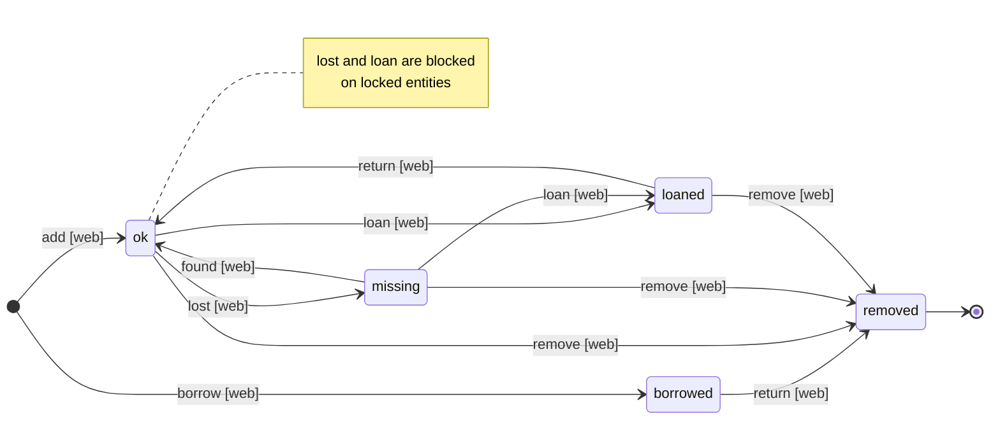

# wherehouse

> Event-sourced CLI inventory tracker: "Where did I put my 10mm socket?"

[](https://github.com/asphaltbuffet/wherehouse/releases)
[](go.mod)
[](LICENSE)

---

## Quick Example

```bash
# Add entities. --locked pins a place so it can't be reparented;
# --discrete marks a terminal item that holds nothing else.
wherehouse add "Garage" --locked
wherehouse add "Garage:Toolbox"
wherehouse add "Garage:Toolbox:10mm socket" --discrete

# Search by name
wherehouse scry "socket"
# → Garage:Toolbox:10mm socket

# Move something
wherehouse move "Garage:Toolbox" --to "Basement"

# View full event history
wherehouse history "Basement:Toolbox:10mm socket"

# Browse everything in a web UI
wherehouse serve
```

---

## Why Wherehouse?

You know you own a 10mm socket wrench. You used it last week. Where is it now?

Wherehouse tracks every entity's location with a complete audit trail. Event-sourced architecture means you can see where things were, when they moved, and rebuild the entire state from history.

### Key Features

- **Event-Sourced** — append-only event log; projections are derived and rebuildable
- **Unified Entity Model** — locations and items are both entities; hierarchy via colon-separated paths (`Garage:Toolbox:Wrench`)
- **Hierarchical Paths** — arbitrarily nested entities with colon-path addressing
- **Status Tracking** — mark entities as `ok`, `missing`, `borrowed`, `loaned`, or `removed`
- **Home and Displaced** — an entity remembers its home; `use` moves it temporarily and `return` sends it back
- **Full History** — every move, rename, and status change is recorded with actor and timestamp
- **Web UI** — local HTTP server for browsing (including tags), searching, adding, editing, locking, marking discrete, borrowing, loaning, and returning inventory; reports (missing, loaned, borrowed, displaced, by parent, all) with CSV/JSON export and a printable view; works on phones (tree drawer, full-width detail with a contents list)
- **Single-Host Storage** — one SQLite file in WAL mode; share an inventory across machines through the web UI, not by opening the file from more than one host
- **Multi-User Attribution** — trust-based; tracks who made changes, no permissions enforcement
- **Single File Database** — entire inventory in one portable SQLite file

---

## Installation

### Build from Source

**Requirements**: Go 1.26+, SQLite 3.x (embedded via `modernc.org/sqlite`)

```bash
git clone https://github.com/asphaltbuffet/wherehouse.git
cd wherehouse

# Build
go build -o dist/wherehouse .

# Or with mise
mise run build

# Install to user bin
mkdir -p ~/.local/bin
cp dist/wherehouse ~/.local/bin/
```

### Nix

**Standalone install**:

```bash
nix profile install github:asphaltbuffet/wherehouse/v0.10.0
```

**Home Manager** — add as an input and load the bundled module:

```nix
# flake.nix
{
  inputs = {
    nixpkgs.url      = "github:NixOS/nixpkgs/nixpkgs-unstable";
    home-manager.url = "github:nix-community/home-manager";
    wherehouse.url   = "github:asphaltbuffet/wherehouse/v0.10.0";
    wherehouse.inputs.nixpkgs.follows = "nixpkgs";
  };

  outputs = { nixpkgs, home-manager, wherehouse, ... }: {
    homeConfigurations."alice" = home-manager.lib.homeManagerConfiguration {
      pkgs = nixpkgs.legacyPackages.x86_64-linux;
      modules = [
        wherehouse.homeManagerModules.default
        { programs.wherehouse.enable = true; }
      ];
    };
  };
}
```

### Container

A multi-arch (`linux/amd64`, `linux/arm64`) image runs the web UI:

```bash
docker run -d --name wherehouse \
  -p 8080:8080 \
  -v wherehouse:/data \
  ghcr.io/asphaltbuffet/wherehouse:latest
```

- **Tags**: `X.Y.Z` (exact), `X.Y` (latest patch), `latest` (latest stable). Prereleases get only `X.Y.Z-rc.N`.
- **Data**: the database is `/data/wherehouse.db`. Keep `/data` on a volume, or you lose the event log when the container is removed.
- **Bind mounts**: the image runs as uid `65532`. To mount a host directory, either `chown 65532:65532` it or run with `--user "$(id -u):$(id -g)"`; otherwise startup fails with `unable to open database file`.
- **Docker Desktop (macOS/Windows)**: containers run in a VM, so a host bind mount counts as a second host. Don't run the host CLI and the container against the same bind-mounted database; use a named volume and `docker exec`/`docker run` for CLI commands.
- **Arguments**: anything after the image name is passed to `wherehouse serve`, e.g. `... wherehouse:latest --port 9090`.
- **Configuration**: set `WHEREHOUSE_*` environment variables (see [Environment Variables](#environment-variables)), or put a `wherehouse.toml` in `/data` (found as `./wherehouse.toml` because the working directory is `/data`). The image presets `WHEREHOUSE_DATABASE_PATH` and `WHEREHOUSE_LOGGING_FILE_PATH`, and environment variables override the file, so `database.path` and `logging.file_path` in the file are ignored; change them with `-e` instead.
- **Identity**: web edits are recorded as actor `webui`. Only when the container sits behind an authenticating proxy that is its sole ingress (e.g. the sidecar recipe), set `WHEREHOUSE_WEB_ACTOR_HEADER=<header>` to record the proxy's user instead. Never set it together with `-p` publishing the port directly: anyone who reaches the port can forge the header. See [Behind Tailscale Serve](#behind-tailscale-serve).
- **Logs**: written to stderr (`WHEREHOUSE_LOGGING_FILE_PATH=-`); view with `docker logs wherehouse`. Setting `logging.max_size_mb` with the stderr sink is a configuration error.
- **Health**: `GET /healthz` returns 200 when the server is up. Use it for orchestrator probes; the image has no `HEALTHCHECK`.
- **CLI commands**: run them against the same volume with `docker run --rm -v wherehouse:/data --entrypoint /usr/bin/wherehouse ghcr.io/asphaltbuffet/wherehouse:latest doctor`.

#### Behind Tailscale Serve

wherehouse does no authentication of its own ([ADR 0031](docs/adr/0031-web-authentication-delegated-to-trusted-proxy.md)). Put it behind Tailscale Serve, which authenticates tailnet users and sets `Tailscale-User-Login`, and bind to loopback so Serve is the only way in. The sidecar must run in kernel networking mode (`TS_USERSPACE=false`): in the image's default userspace mode, tailnet traffic to the node is delivered to `127.0.0.1`, so a loopback bind alone does not keep peers out. The tailnet also needs MagicDNS and HTTPS certificates enabled for `"HTTPS": true` / `${TS_CERT_DOMAIN}`.

```yaml
services:
  tailscale:
    image: tailscale/tailscale:latest
    hostname: wherehouse
    environment:
      - TS_AUTHKEY=${TS_AUTHKEY}
      - TS_STATE_DIR=/var/lib/tailscale
      - TS_SERVE_CONFIG=/config/serve.json
      - TS_USERSPACE=false
    devices:
      - /dev/net/tun:/dev/net/tun
    cap_add:
      - NET_ADMIN
    volumes:
      - ts-state:/var/lib/tailscale
      - ./serve.json:/config/serve.json:ro
  wherehouse:
    image: ghcr.io/asphaltbuffet/wherehouse:latest
    network_mode: service:tailscale
    command: ["--bind", "127.0.0.1"]   # overrides the image's 0.0.0.0
    environment:
      - WHEREHOUSE_WEB_ACTOR_HEADER=Tailscale-User-Login
    volumes:
      - wherehouse:/data
volumes:
  ts-state:
  wherehouse:
```

`serve.json`:

```json
{
  "TCP": { "443": { "HTTPS": true } },
  "Web": { "${TS_CERT_DOMAIN}:443": { "Handlers": { "/": { "Proxy": "http://127.0.0.1:8080" } } } }
}
```

Without `--bind 127.0.0.1`, the listener is reachable on the node's tailnet IP and any peer can bypass Serve and forge the header; `serve` prints a warning at startup in that case. As defence in depth, restrict the node to port 443 in your tailnet ACLs/grants.

Verify from another tailnet device: `curl -H 'Tailscale-User-Login: mallory' http://wherehouse:8080/` must fail to connect. The page header shows `acting as …` so you can confirm the identity arrives through Serve.

---

## Quick Start

### 1. Initialize Config

```bash
wherehouse config init
# → Created config at ~/.config/wherehouse/wherehouse.toml
```

The database is created automatically on first use at `~/.local/share/wherehouse/wherehouse.db`.

### 2. Add Entities

Everything is an `Entity` — there is no separate "place", "container", or "item"
type. Entities are distinguished by their position in the hierarchy and two optional
attributes:

| Attribute | Effect |
|---|---|
| `--locked` | Pins the entity so it cannot be directly reparented (use for fixed places like a room or shelf) |
| `--discrete` | Marks a terminal item that holds nothing — adding children to it is blocked (use for a single tracked item) |

A plain `add` with neither flag creates a movable holder (e.g. a box or toolbox).

```bash
# Build a hierarchy
wherehouse add "Garage" --locked
wherehouse add "Garage:Toolbox"                    # nested path creates under Garage

# Add individual items
wherehouse add "Garage:Toolbox:10mm socket" --discrete
wherehouse add "Garage:Toolbox:Ratchet" --discrete
```

Paths are colon-separated from the root. Providing a nested path like `Garage:Toolbox:Wrench` will add `Wrench` under the existing `Garage:Toolbox` entity.

Attributes can be changed later with `attr` (use the `=` form to clear):

```bash
wherehouse attr "Garage:Toolbox"                      # show locked/discrete
wherehouse attr "Garage:Toolbox" --locked             # lock (only ok or borrowed entities)
wherehouse attr "Garage:Toolbox" --locked=false       # unlock
wherehouse attr "Garage:Box of Nails" --discrete      # only when it holds nothing
```

### 3. Search

```bash
# Search by name (substring matching)
wherehouse scry "socket"
# → Garage:Toolbox:10mm socket

# List all entities
wherehouse scry

# JSON output for scripting
wherehouse scry "socket" --json
```

### 4. Move Entities

```bash
# Move a container (and everything in it) to a new parent
wherehouse move "Garage:Toolbox" --to "Basement"

# Move a single item
wherehouse move "Garage:Toolbox:Ratchet" --to "Garage:Pegboard"
```

Locked entities (`--locked`) cannot be directly reparented. A `missing` entity must be found first (`wherehouse found`), and a `loaned` entity must be returned first (`wherehouse return`). An entity cannot be moved into itself, anything inside it, or the parent it is already in.

### 5. View History

```bash
# Full event timeline for an entity (newest first)
wherehouse history "Basement:Toolbox:10mm socket"

# JSON output
wherehouse history "Basement:Toolbox" --json
```

### 6. Track Status

Status is read-only; each transition has its own intent-driven command.

```bash
# Show the current status of an entity (read-only)
wherehouse status "Basement:Toolbox:10mm socket"

# Mark something as missing (only ok entities can be marked missing)
wherehouse lost "Basement:Toolbox:10mm socket"

# Recover a missing entity
wherehouse found "Basement:Toolbox:10mm socket"

# Lend something out (recipient required)
wherehouse loan "Garage:Ladder" --to "Bob" --note "lent for the weekend"

# Bring a loaned (or borrowed) entity back; a borrowed entity is removed,
# and must not still contain other entities
wherehouse return "Garage:Ladder"

# Temporarily move something, keeping its home; return sends it back
wherehouse use "Garage:Shelf:Drill" --to "Deck"
wherehouse use "Garage:Shelf:Drill" --to "Deck" --note "deck project"
wherehouse return "Deck:Drill"

# Track an externally-owned item brought into the inventory
wherehouse borrow "Garage:Alice's Drill" --from "Alice"
```

#### Home and displaced entities

Every entity has a home. `use` moves an entity elsewhere without changing its home, so it shows as displaced (an "away" tag in the web UI) until `return` sends it home; `move` makes the new place its home. See the Home, Displaced, Use, and Return entries in [CONTEXT.md](CONTEXT.md) and [ADR 0039](docs/adr/0039-home-is-a-persistent-reference-and-displaced-is-derived.md).

#### Status Lifecycle

Legal transitions (see [ADR 0024](docs/adr/0024-status-transition-commands-enforce-source-preconditions.md)). Edges marked `[web]` are also available in the web UI; all others are CLI-only.



Non-status actions, by interface:

| Action | CLI | Web UI | Notes |
|---|:-:|:-:|---|
| add | ✅ | ✅ | web form has no `--locked` / `--discrete` / `--create-parents` |
| rename | ✅ | ✅ | |
| attr (lock / discrete) | ✅ | ✅ | web has one button per attribute; disabled with a tooltip when blocked |
| move | ✅ | ✅ | web form has a searchable destination picker and a "Move to root" choice; disabled with a tooltip for locked, missing, or loaned entities |
| remove | ✅ | ✅ | web form asks for an optional note; hidden for borrowed entities (use Return); disabled with a tooltip while the entity contains other entities |
| lost / found | ✅ | ✅ | web uses one toggle that is hidden for locked entities (a locked entity can never be `missing`; unlock it first) |
| loan | ✅ | ✅ | web form asks for "Loaned to" and an optional note; disabled for locked entities |
| borrow | ✅ | ✅ | web creates one entity per submit, with a searchable location picker defaulting to the entity being viewed |
| use | ✅ | ✅ | temporary move that keeps the entity's home; web form labelled "Use at" |
| return | ✅ | ✅ | also sends displaced entities home; web asks for confirmation before returning a borrowed entity |
| scry / list | ✅ | ✅ | web has search and tree browsing; no status filter |
| history | ✅ | ❌ | |
| export / doctor | ✅ | ❌ | |

### 7. List Entities

```bash
# List everything
wherehouse list

# List under a specific path
wherehouse list --under "Garage:Toolbox"

# Filter by status
wherehouse list --status missing

# Show entities away from their home, or those whose home is under a path
wherehouse list --displaced
wherehouse list --home-under "Garage:Shelf"
```

### 8. Rename Entities

```bash
wherehouse rename "Garage:Toolbox" --to "Tool Chest"
```

### 9. Remove Entities

An entity that still contains other entities cannot be removed; remove or move them first.

```bash
wherehouse remove "Garage:Tool Chest:Broken Wrench"
wherehouse remove "Garage:Old Box" --note "disposed"
```

### 10. Export Event Log

```bash
# Export all events as NDJSON (one JSON object per line)
wherehouse export

# Suppress the "no events" warning when the database is empty
wherehouse export --quiet
```

The `--json` flag is accepted silently (the command always emits NDJSON).

### 11. Check Inventory Health

```bash
# Run all checks (config, event log, projection consistency)
wherehouse doctor

# Rebuild the projection from the event log when checks pass
wherehouse doctor --rebuild

# Rebuild even if issues are found
wherehouse doctor --rebuild --force

# JSON output (healthy flag + issue list)
wherehouse doctor --json
```

Exit code is non-zero when any issue is found, making it safe to use in scripts.

### 12. Web UI

```bash
# Start local web server (default: http://127.0.0.1:8080)
wherehouse serve

# Custom port or bind address
wherehouse serve --port 9090
wherehouse serve --bind 0.0.0.0   # share on LAN
wherehouse serve --actor-header Tailscale-User-Login   # trust a proxy identity header
```

Open `http://localhost:8080` in your browser. From the UI you can browse the full entity tree, search, add entities, edit names, toggle item status, and lock/unlock or mark entities discrete.

---

## Commands

```
wherehouse <command> [flags]

Entity Management:
  add <path>           Add an entity (--locked, --discrete, --create-parents)
  attr <path>...       Show/set locked & discrete (--locked[=bool], --discrete[=bool])
  move <path>          Move an entity to a new parent (--to <dest>)
  rename <path>        Rename an entity (--to <new-name>)
  remove <path>        Remove an entity from the inventory
  list                 List entities (--under, --status, --displaced, --home-under)
  scry [<name>]        Search entities by name, or list all
  history <path>       Show full event timeline for an entity

Status:
  status <path>        Show the current status of an entity (read-only)
  lost <path>...       Mark entities as missing (from ok)
  found <path>...      Recover missing entities (to ok)
  loan <path>...       Lend entities out (--to <recipient>)
  use <path>           Temporarily move an entity, keeping its home (--to <dest>)
  return <path>...     Restore status and location: back from loan/lender, or home
  borrow <path>...     Track externally-owned items (--from <lender>)
  export               Export all events as NDJSON to stdout
  doctor               Check inventory health (--rebuild, --rebuild --force)

Web UI:
  serve                Start local web server (--port, --bind, --actor-header)

Configuration:
  config init          Create config file with defaults (--local, --force)
  config check         Validate config file(s)
  config path          Show config file path(s)

Global Flags:
  -h, --help           Show help
  --version            Show version
  --config <path>      Custom config file path
  --no-config          Skip all config files (use defaults only)
  --db <path>          Override database path
  --as <identity>      Override user identity
  --json               Output as JSON
  -q, --quiet          Quiet mode (-q minimal, -qq silent)
```

---

## Configuration

### File Locations (XDG-Compliant)

**Config file** (in priority order):
1. `--config <path>` flag
2. `$WHEREHOUSE_CONFIG` environment variable
3. `./wherehouse.toml` (current directory)
4. `~/.config/wherehouse/wherehouse.toml` (default)

**Data**: `~/.local/share/wherehouse/wherehouse.db`

### Config File

```bash
wherehouse config init
```

Generated `~/.config/wherehouse/wherehouse.toml`:

```toml
[database]
path = "~/.local/share/wherehouse/wherehouse.db"

[logging]
level = "warn"
# file_path = "~/.local/state/wherehouse/wherehouse.log"
# file_path = "-"   # log to stderr; max_size_mb must stay 0
# max_size_mb = 10   # must be >= 0
# max_backups = 3    # must be >= 0

[user]
default_identity = ""
os_username_map = {}

[output]
default_format = "human"
quiet = 0   # 0 = normal, 1 = minimal (-q), 2 = silent (-qq)

[web]
actor_header = ""
```

### Environment Variables

Environment variables override values from any config file; command-line flags (e.g. `--db`) override both.

```bash
export WHEREHOUSE_DATABASE_PATH="/mnt/nas/wherehouse.db"
export WHEREHOUSE_CONFIG="$HOME/projects/workshop/wherehouse.toml"
export WHEREHOUSE_LOGGING_FILE_PATH="/var/log/wherehouse/wherehouse.log"   # or "-" for stderr
export WHEREHOUSE_OUTPUT_DEFAULT_FORMAT="json"
export WHEREHOUSE_WEB_ACTOR_HEADER="Tailscale-User-Login"
```

### Home Manager

```nix
programs.wherehouse = {
  enable = true;

  settings = {
    database.path = "~/.local/share/wherehouse/wherehouse.db";

    user = {
      defaultIdentity = "";
      osUsernameMap = { jdoe = "John Doe"; };
    };

    logging = {
      level = "warn";
    };

    output = {
      defaultFormat = "human";
      quiet = 0;
    };

    web = {
      actorHeader = "Tailscale-User-Login"; # only behind a proxy that is the sole path to serve
    };
  };
};
```

| Option | Type | Default | Description |
|---|---|---|---|
| `settings.database.path` | string | XDG data dir | Path to SQLite database file |
| `settings.logging.filePath` | string | XDG state dir | Path to log file, or `"-"` for stderr |
| `settings.logging.level` | `"debug"`…`"error"` | `"warn"` | Minimum log level |
| `settings.logging.maxSizeMB` | unsigned int | `0` (disabled) | Max log size before rotation |
| `settings.logging.maxBackups` | unsigned int | `3` | Old rotated files to keep |
| `settings.user.defaultIdentity` | string | OS username | Display name for attribution |
| `settings.user.osUsernameMap` | attrset | `{}` | Map OS usernames to display names |
| `settings.output.defaultFormat` | `"human"` \| `"json"` | `"human"` | Default output format |
| `settings.output.quiet` | `0`…`2` | `0` | Quiet level: 1 = minimal (`-q`), 2 = silent (`-qq`) |
| `settings.web.actorHeader` | string \| `null` | `null` | Trusted reverse-proxy header whose value is recorded as the web actor (see [Behind Tailscale Serve](#behind-tailscale-serve)) |

---

## Architecture

### Event Sourcing

- **Events** are the source of truth (append-only log, never modified)
- **Projections** are derived state (rebuildable from events)
- **Replay** ordered strictly by `event_id` — timestamps are informational only
- **No undo** — corrections create new compensating events

**Events table** (source of truth):
```sql
CREATE TABLE events (
  event_id         INTEGER PRIMARY KEY AUTOINCREMENT,
  event_type       TEXT NOT NULL,
  timestamp_utc    TEXT NOT NULL,
  actor_user_id    TEXT NOT NULL,
  payload          TEXT NOT NULL,  -- JSON
  note             TEXT
);
```

**Projection tables** (derived, rebuildable):
- `locations_current` — current entity hierarchy
- `items_current` — current entity state
- `projects_current` — active and completed projects

---

## Development

### Prerequisites

- Go 1.26+
- [mise](https://mise.jdx.dev/) (recommended for task automation)

### Build & Test

```bash
# Build
mise run build        # → dist/wherehouse

# Test (race detector + coverage)
mise run test

# Lint
mise run lint

# Full pipeline
mise run dev        # binary lands in dist/<os>_<arch>_<variant>/wherehouse
```

---

### Releasing

The changelog (`.changes/`) is the single source of truth for versions. Releases are triggered by pushing a version tag to GitHub — there is no `VERSION` file.

**To cut a release:**

1. As you work, use `changie new` to record user-facing changes in `.changes/unreleased/`. This is optional for non-user-facing changes (tooling, CI, docs) — but at least one fragment must exist before a release.
2. Run `mise run pre-release <major|minor|patch>` — this:
   - Hard-fails if no unreleased fragments exist
   - Runs `changie batch <bump>` to create `.changes/<version>.md`
   - Runs `changie merge` to update `CHANGELOG.md`
   - Updates nix flake pins in this file
3. Commit `.changes/`, `CHANGELOG.md`, and `README.md` together and open a PR
4. After the PR merges, run `mise run release` — this:
   - Asserts the working copy is clean and `@` is on trunk
   - Asserts the tag doesn't already exist
   - Asserts `CHANGELOG.md` has an entry for the version
   - Creates and pushes the `v<version>` tag

When the tag push lands, CI:
- Extracts the version from the tag name
- Asserts `CHANGELOG.md` has a matching entry
- Runs goreleaser with `.changes/<version>.md` as the release notes

**Non-user-facing changes** (dependency bumps, CI fixes, tooling) should not trigger a release. Merge them to main without running `pre-release` — they will be bundled into the next release that does have user-facing changes.

---

## Troubleshooting

### `SQLITE_BUSY` / lock errors

Another process is holding a write lock longer than the busy timeout.

```bash
ps aux | grep wherehouse
```

### Network mounts

The database may live on NFS/SMB only if every process that opens it runs on the same host. WAL mode keeps a shared-memory index (`wherehouse.db-shm`) that cannot be shared between machines; two hosts opening the same file can corrupt it, and file locking does not prevent that. To share an inventory between machines, run `wherehouse serve` on one host.

### Performance degradation

```bash
# Check database size
ls -lh ~/.local/share/wherehouse/wherehouse.db
```

